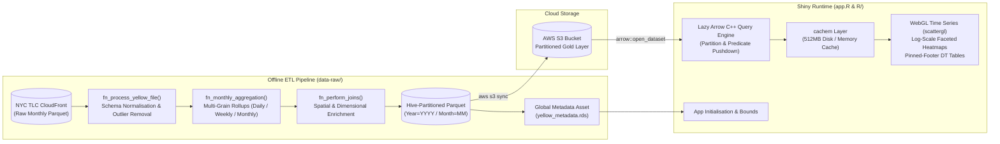

# NYC Yellow Taxi Analytics Platform (R Shiny & Apache Arrow)

[](https://github.com/kcmcleod/nyc_taxi_shiny_app/actions/workflows/ci-cd.yml)
[](https://codecov.io/gh/kcmcleod/nyc_taxi_shiny_app)

An analytical R Shiny application engineered to query, aggregate, and visualise multi-million-row New York City Yellow Taxi trip records with sub-second latency. Powered by **Apache Arrow** and a **Hive-partitioned Parquet** located on **AWS S3**. The platform delivers interactive OLAP slicing without the operational overhead or idle compute cost of a traditional relational database.

---

## System Architecture

The system decouples offline batch ETL processing from the online interactive Shiny runtime using a Medallion-style data architecture:



---

## Key Engineering Decisions & Trade-Offs

### 1. Out-of-Core Apache Arrow + S3 Parquet vs. RDBMS
- **Decision:** Query Hive-partitioned Parquet files (`Year`/`Month`) directly via `arrow::open_dataset()` rather than provisioning a persistent PostgreSQL/RDS instance.
- **Rationale:** Analytical dashboard workloads are read-heavy and bursty. Arrow's C++ execution engine prunes Hive partitions by `Year` and pushes predicate filtering (`filter()`) and column projection (`select()`) down to the Parquet file footers before materialising only the aggregated summary rows into R memory via `collect()`. Benchmarking (`dev/profiling/profile_ram.R`) confirms this reduces peak R RAM allocation by >95% compared to in-memory dataframe filtering, allowing deployment within 1GB container environments (`shinyapps.io`).

### 2. Memory-Bounded Batch ETL, Pre-Aggregated Tiers (`T2–T4`) & Late-Arriving Data
- **Decision:** Process raw NYC TLC Parquet files in configurable, garbage-collected batches (`max_num_of_parquet_to_process: 15`), pre-computing Daily, Weekly, and Monthly dimensional rollups (`VendorID`, `payment_type`, `RatecodeID`, `PULocationID`, `DOLocationID`) and writing partitions using unique batch-timestamped `basename_template` filenames.
- **Rationale:** Raw NYC TLC monthly files contain 3M–4M rows each and exhibit upstream schema drift (e.g., `airport_fee` vs. `Airport_fee`, `cbd_congestion_fee`) as well as late-arriving December records inside January files. Batch chunking bounds peak ETL memory, multi-grain rollups compress data volume by an order of magnitude while preserving exact additive metrics. Timestamped partition templates prevent late-arriving cross-month records from overwriting existing partition files.

### 3. Client-Side GPU Rendering & Outliers (`scattergl` & $\log_{10}$ Heatmaps)
- **Decision:** Render time-series traces using Plotly WebGL (`type = "scattergl"`) and apply a $\log_{10}(z + 1)$ transformation to origin-destination borough heatmaps.
- **Rationale:** Standard SVG rendering degrades browser DOM performance across multi-series daily timelines. Offloading line rendering to WebGL maintains 60fps interactivity. Logarithmic colour scaling prevents intra-Manhattan trip volumes from washing out outer-borough route variance. Unscaled counts appear in the hover.

### 4. Defensive Resource Guardrails & Reactive Caching
- **365-Day Window Clamping & Query Circuit Breakers:** The parent module clamps interactive date-range selections to a maximum 365-day window, while downstream aggregation functions enforce single-pass row-count circuit breakers (`row_limit = 15e6`) prior to presentation materialisation to prevent Out-Of-Memory (OOM) container crashes.
- **Version-Keyed Reactive Caching (`bindCache`):** Expensive aggregations and compiled Plotly widgets are cached via `{cachem}` using composite keys bound to the dataset's temporal watermark (`min_date_max_date`) and active UI inputs.
- **WebSocket Idle Reclamation:** A custom throttled JavaScript activity monitor (`www/idle_time_out.js`) warns inactive users at 14 minutes and terminates idle Shiny sessions at 15 minutes (`session$close()`), actively freeing server RAM.

---

## Quality Assurance & Testing Pyramid (97% Coverage)

The repository enforces a four-tier automated testing strategy executed via GitHub Actions on every push and pull request:

1. **Static Analysis & Formatting Gates:** Code formatting and static analysis are enforced in CI via `{styler}` (`git diff --exit-code`) and `{lintr}`.
2. **End-to-End ETL Regression Testing (`{diffdf}`):** `tests/testthat/test_etl_regression.R` runs the complete ingestion and lookup enrichment pipeline against a frozen stratified 500-row raw Parquet baseline (`tests/testdata/`). This verifies zero mathematical or schema drift against a known-good golden `.rds` output.
3. **Isolated Module & Boundary Unit Tests (`{testthat}` & `shiny::testServer`):** Comprehensive unit tests verify defensive error traps, schema validation helpers, and reactive server graph transitions in isolation (>85% line coverage gate enforced via Codecov; currently **97%**).
4. **Headless Browser E2E Snapshot Tests (`{shinytest2}`):** `tests/testthat/test_sf_trip_data.R` drives a headless Chromium instance to verify end-to-end UI rendering, exported reactive state snapshots, and client-server date-range clamping (365-day guardrail).

---

## Local Development & Operations (Zero-Config Quickstart)

A `Makefile` is provided for instant reviewer onboarding (using bundled test fixtures in `tests/testdata/` without needing AWS credentials) as well as full local development and testing:

```bash
make setup     # Restore exact R package environment from renv.lock
make run-demo  # Launch app immediately using bundled demo data (no AWS keys required)
make run-dev   # Launch app for local dev work against full partitioned Parquet dataset
make test      # Run full testthat + shinytest2 suite (218 tests) in offline test mode
make coverage  # Generate interactive HTML test coverage report via {covr}
make poll      # Poll NYC TLC CloudFront for newly published monthly Parquet files
make sync      # Sync local Hive-partitioned Parquet gold layer to AWS S3
make help      # Display all available Makefile targets
```

### Environment Variables
For full local development (`make run-dev`), set `DEPLOY_ENV=DEVELOPER` in `.Renviron` to use local disk storage (`data/yellow_aggregation_partitioned`) and in-memory caching (`cachem::cache_mem()`). Production deployments read from AWS S3 (`TAXI_S3_BUCKET`, `TAXI_S3_OBJECT`, `AWS_ACCESS_KEY_ID`, `AWS_SECRET_ACCESS_KEY`) with persistent 512MB disk caching (`cachem::cache_disk()`).

---

## Data Source
Trip record data provided by the [NYC Taxi and Limousine Commission (TLC) Trip Record Data](https://www.nyc.gov/site/tlc/about/tlc-trip-record-data.page).